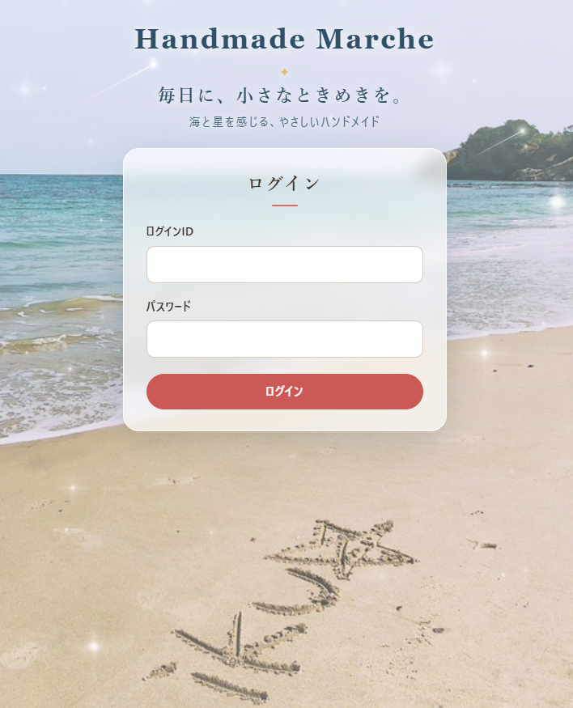
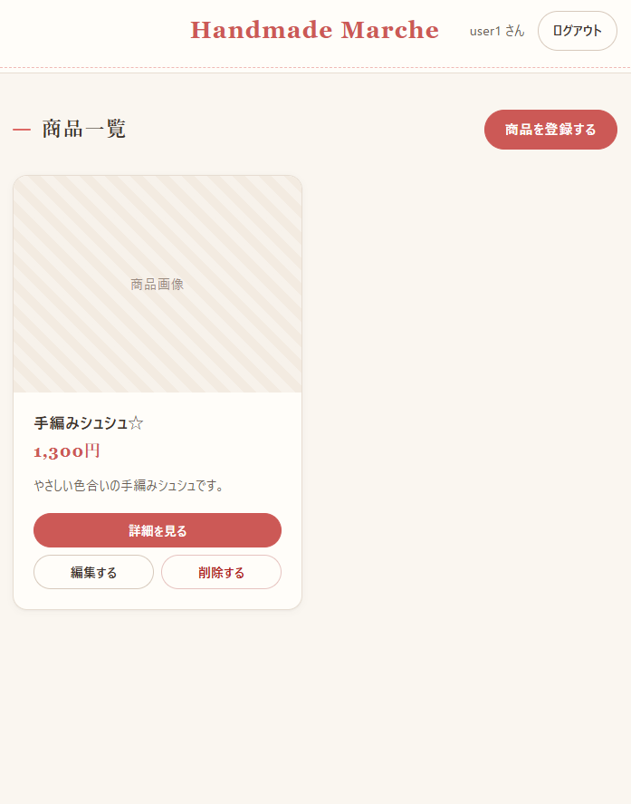
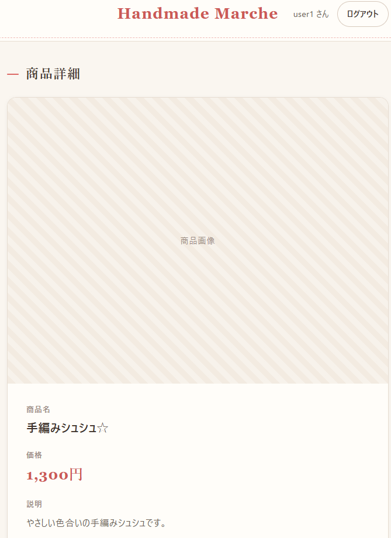
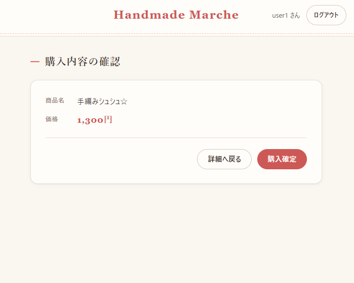
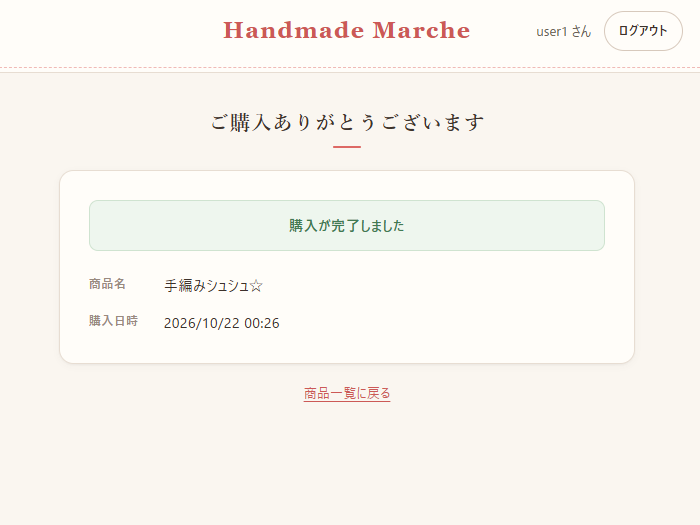
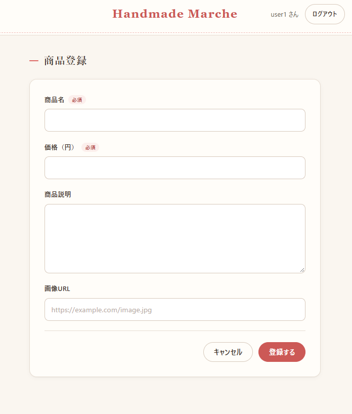
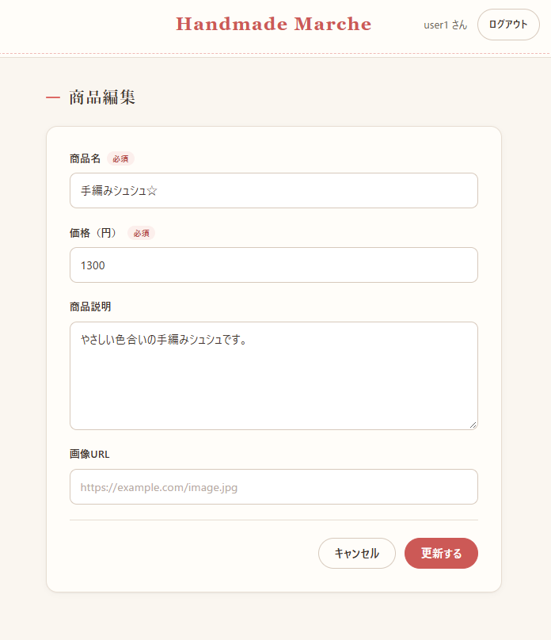
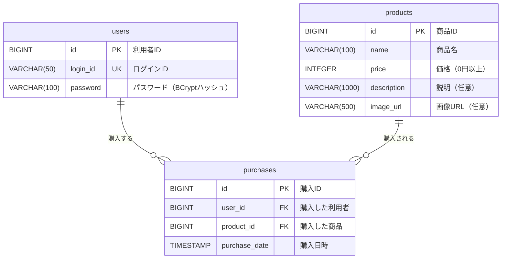

# Handmade Marche（ハンドメイド・マルシェ）

> **手作りの小物を気軽に見つけて購入できるハンドメイド販売アプリ**


## アプリ概要

Handmade Marche は、シュシュ・ヘアアクセサリー・編み物などのハンドメイド作品を探して購入できる Web アプリです。

ログインした利用者は、次の流れで買い物ができます。

```
ログイン → 商品一覧 → 商品詳細 → 購入内容の確認 → 購入完了
```

画面は、初めて使う人でも商品を探しやすいように、シンプルで見やすく、やさしい雰囲気のデザインにしています。

## 制作背景・理由

- **作品との出会いの場をつくりたい**：ハンドメイド作品を気軽に探して購入できる場をつくり、手作りならではの商品との出会いを楽しめるようにしたいと考えました。
- **作品を探している人と作品をつなぐ**：作品を見やすく紹介するシンプルな販売アプリにすることで、作品を探している人と作品をつなげることを目指しました。
- **迷わず購入まで進める**：商品一覧から気になる作品を見つけ、詳細を確認し、購入まで分かりやすく進められる画面の流れにしました。
- **Web アプリの基本を一通り身につける**：フロントエンド（React）とバックエンド（Spring Boot）を分けて作りました。ログイン認証、データの登録・取得・更新・削除、テストまで、Web アプリ開発の基本的な流れを一通り実装しています。

## 主な機能

### ログイン・ログアウト
- ログインIDとパスワードでログインできます。未入力のときや、認証に失敗したときはエラーを表示します。
- ログインしていない状態でどの画面を開いても、ログイン画面に移動します。ログインすると、開こうとしていた画面に戻ります。
- ヘッダーに「○○ さん」とログアウトボタンを表示します。
- 30分間操作がないと、ログインの有効期限が切れます。期限が切れたまま操作するとログイン画面に移動し、その旨を表示します。

### 商品一覧
- 登録されている商品を、2列のカードで一覧表示します。カードには商品画像、商品名、価格、説明を表示します。
- 画像が登録されていない商品や、画像を読み込めない商品には「商品画像」の枠を表示します。

### 商品詳細
- 一覧の「詳細を見る」から、選んだ商品の画像・商品名・価格・説明を確認できます。
- 「購入へ進む」で購入画面へ、「一覧へ戻る」で商品一覧へ移動します。

### 購入
- 購入画面で商品名と価格を確認し、「購入確定」を押すと購入が完了します。
- 購入完了画面には、購入した商品名と購入日時を表示します。
- 購入確定ボタンの二重押しや、ブラウザの「戻る」で再び購入してしまうことを防いでいます。
- 購入情報は、本人だけが表示できます。
- 本格的なオンライン決済は行いません。購入操作を簡略化しています。

### 商品の登録・編集・削除
- 商品一覧から商品を登録・編集・削除できます。入力項目は商品名、価格、説明、画像URLです。
- 入力内容はフロントエンドとバックエンドの両方でチェックし、誤りがあれば項目ごとにエラーを表示します。
- 削除する前に確認ダイアログを表示します。購入された商品は削除できません。

### セキュリティ
- パスワードは BCrypt でハッシュ化して保存します。平文では保存しません。
- ログイン状態はセッションで管理します。Cookie は HttpOnly と SameSite=Lax を設定しています。
- ログイン時にセッションIDを新しくして、セッション固定攻撃を防いでいます。
- データを変更するリクエストには CSRF トークンが必要です。

## 画面一覧

| 画面 | URL | 内容 |
| --- | --- | --- |
| ログイン画面 | `/login` | ログインIDとパスワードを入力してログインする |
| 商品一覧画面 | `/products` | 商品をカードで一覧表示する |
| 商品詳細画面 | `/products/{id}` | 選んだ商品の詳しい情報を表示する |
| 購入画面 | `/purchase/{id}` | 購入内容を確認し、購入を確定する |
| 購入完了画面 | `/purchase/complete/{id}` | 購入が完了したことと購入内容を表示する |
| 商品登録画面 | `/products/new` | 商品を新しく登録する |
| 商品編集画面 | `/products/{id}/edit` | 登録済みの商品を編集する |

## 画面イメージ

### ログイン



### 商品一覧



### 商品詳細



### 購入内容の確認



### 購入完了



### 商品登録



### 商品編集



## 使用技術

| 区分 | 技術 |
| --- | --- |
| フロントエンド | React 19 / React Router 7 / Vite 8（JavaScript） |
| バックエンド | Java 21 / Spring Boot 4.1（Spring Web MVC、Spring Data JPA、Spring Security、Bean Validation） |
| データベース | H2 Database（ファイルモード。アプリを再起動してもデータが残ります） |
| ビルドツール | Maven（Maven Wrapper）/ npm |
| テスト | JUnit 5・MockMvc（バックエンド）、Vitest・Testing Library（フロントエンド） |
| 静的解析 | Oxlint |

### システム構成

```
ブラウザ
  │  http://localhost:5173
  ▼
フロントエンド（React + Vite 開発サーバー）
  │  /api/** を転送
  ▼
バックエンド（Spring Boot REST API）  http://localhost:8080
  │
  ▼
データベース（H2：backend/data/）
```

フロントエンドからの `/api` へのリクエストは、Vite の開発サーバーがバックエンドへ転送します。そのため、CORS の設定は必要ありません。

## ER図



- 1人の利用者は複数の購入をすることができ、1つの商品は複数回購入されることがあります（どちらも1対多）。
- 1件の購入は、利用者1人・商品1点に紐づきます。購入数量と在庫は扱いません。

## API一覧

`/api/login` と `/api/health` 以外の API は、ログインが必要です。ログインしていないと 401 を返します。

| メソッド | URL | 内容 | 主なレスポンス |
| --- | --- | --- | --- |
| POST | `/api/login` | ログイン | 200 / 400 入力不備 / 401 認証失敗 |
| POST | `/api/logout` | ログアウト | 204 |
| GET | `/api/me` | ログイン中の利用者を取得 | 200 / 401 |
| GET | `/api/products` | 商品一覧を取得 | 200 |
| GET | `/api/products/{id}` | 商品詳細を取得 | 200 / 404 |
| POST | `/api/products` | 商品を登録 | 201 / 400 |
| PUT | `/api/products/{id}` | 商品を更新 | 200 / 400 / 404 |
| DELETE | `/api/products/{id}` | 商品を削除 | 204 / 404 / 409 購入済み |
| POST | `/api/purchases` | 購入を登録 | 201 / 400 / 404 |
| GET | `/api/purchases/{id}` | 購入結果を取得 | 200 / 403 他人の購入 / 404 |
| GET | `/api/health` | 動作確認 | 200 |

## フォルダ構成

```
Handmade Marche/
├── frontend/                 React アプリ（http://localhost:5173）
│   └── src/
│       ├── api/              API の呼び出し
│       ├── auth/             ログイン状態の管理
│       ├── components/       共通部品（商品フォーム、商品画像）
│       ├── pages/            各画面とそのテスト
│       └── utils/            表示形式（価格・日時）
└── backend/                  Spring Boot API（http://localhost:8080）
    └── src/main/java/com/handmademarche/
        ├── controller/       API の窓口
        ├── service/          業務処理
        ├── repository/       データベース操作
        ├── entity/           テーブルに対応するクラス
        ├── dto/              リクエスト・レスポンスの形
        ├── security/         認証の設定
        ├── config/           初期ユーザーの作成
        └── exception/        エラー
```

## ローカルでの起動方法

### 必要な環境

- Java 21
- Node.js と npm（開発時は Node.js v24 で動作を確認しています）
- Google Chrome

Maven は Maven Wrapper（`mvnw`）を使うので、別にインストールする必要はありません。

### 1. バックエンドを起動する

```bash
cd backend
./mvnw spring-boot:run      # Windows（PowerShell）は .\mvnw.cmd spring-boot:run
```

- http://localhost:8080/api/health を開いて `{"app":"Handmade Marche","status":"ok"}` が表示されれば、起動しています。
- テーブルは、起動時に自動で作成されます。

### 2. フロントエンドを起動する

別のターミナルで実行します。

```bash
cd frontend
npm install                 # 初回のみ
npm run dev
```

### 3. ブラウザで開く

http://localhost:5173 を開くと、ログイン画面が表示されます。

初回起動時、利用者が1人もいなければ、次の初期ユーザーが自動で作成されます（開発・デモ用）。

| ログインID | パスワード |
| --- | --- |
| `user1` | `password123` |

### 4. 商品を登録する

初回起動時は、商品が登録されていません。商品一覧の「商品を登録する」から商品を登録すると、商品詳細の確認から購入までを試せます。

### 補足

- 初期ユーザーは、`backend/src/main/resources/application.properties` の `app.initial-user.*` で変更できます。ただし、すでに利用者がいる場合は作成されません。変更を反映するには、`backend/data/` を削除してから起動してください。
- データは `backend/data/` に保存されます。このフォルダを削除すると、商品・購入情報・利用者が初期化されます。
- H2 コンソール（http://localhost:8080/h2-console）で、データベースの中身を確認できます。
  - JDBC URL：`jdbc:h2:file:./data/handmade-marche`
  - ユーザー名：`sa`
  - パスワード：なし

## テスト

```bash
cd backend
./mvnw test                 # Windows（PowerShell）は .\mvnw.cmd test

cd frontend
npm test                    # テスト
npm run lint                # 静的解析
```

- バックエンド：74件。ログイン、商品API、購入API、ログインしていないときのアクセス制限を確認します。
- フロントエンド：88件。各画面の表示と操作、入力チェック、エラー表示、ログインから購入までの流れを確認します。
